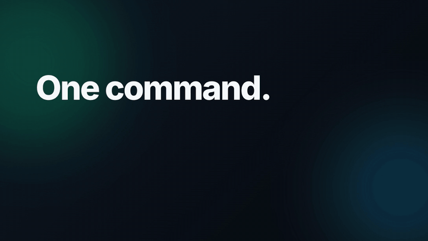
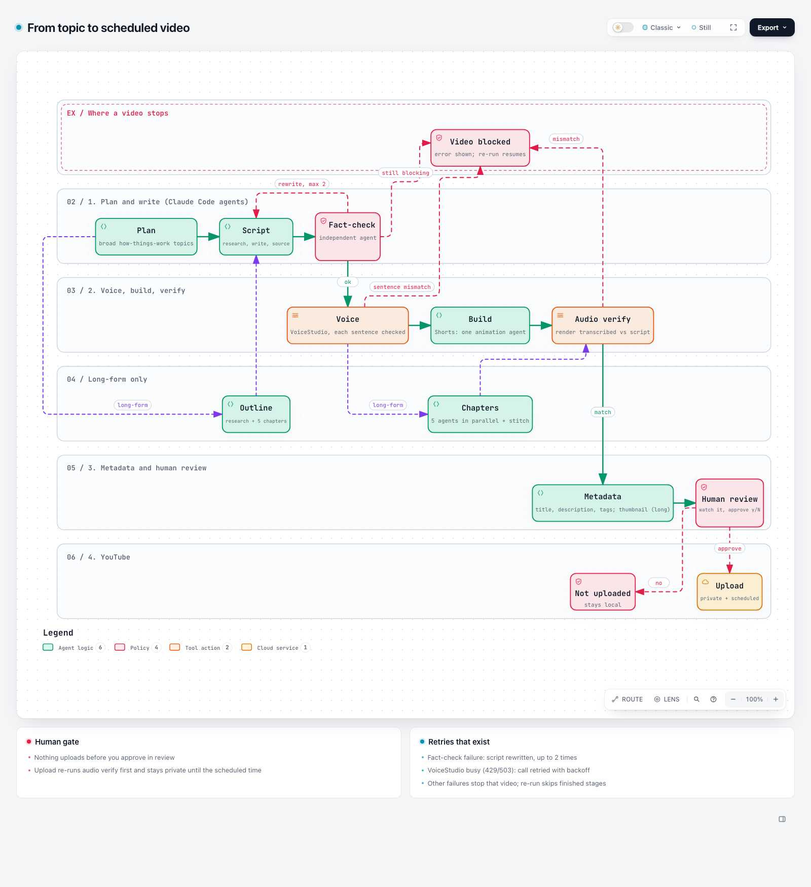
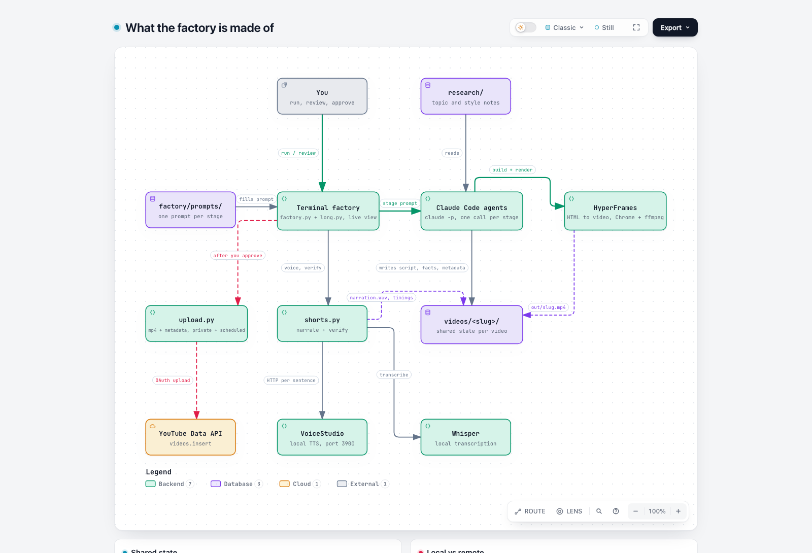

# Built by Agents: YouTube channel system



[Watch the 34 s showcase video](docs/media/factory-showcase.mp4)

Faceless YouTube channel (`@builtbyagents12`) of **animated "how things actually work" explainers for a general audience** (Shorts of 18-30 s and long-form of 4-10 min; AI is at most 1 in 5 topics). Claude writes each animation as code (HyperFrames), a synthetic voice narrates, every fact is checked, and a terminal "factory" runs the whole pipeline. You approve each video before it is uploaded.

Goal: YouTube Partner Program (1,000 subscribers + 4,000 public long-form watch hours) by **2027-01-31**, because the bar doubles to 8,000 hours / 20M Shorts views on 2027-02-01 for new applicants.

## How it works


Interactive versions: `docs/diagrams/pipeline-workflow.html`, `docs/diagrams/factory-architecture.html`.

## Quick start (in your own Terminal window)
Long-form (16:9, about 4-10 min): `factory/run.sh long run --topic "slug:angle" --minutes 5 --chapters 5`, live view `factory/run.sh long watch`. Shorts commands below.

```
cd ~/Projects/youtube-os
factory/run.sh run --count 7      # auto-picks 7 topics, you confirm, then watch the pipeline work
factory/run.sh review             # plays each finished video, you approve (y) -> uploaded private + scheduled
factory/run.sh watch              # read-only live view of any run
factory/run.sh status             # one-shot table of every video's stages
```
Needs: the **VoiceStudio** desktop app running (voice server on :3900), and Claude Code logged in (`claude` command).

## Map of this folder
| Path | What it is |
|---|---|
| `factory/` | The pipeline engine and live terminal view (`factory.py`, `run.sh`, `prompts/` = one prompt per stage) |
| `videos/<slug>/` | One folder per video: `script.txt`, `SOURCES.md`, `facts.json`, `assets/narration.wav`, `timings.json`, `index.html`, `out/<slug>.mp4`, `metadata.json`, `README.md`, `CREDITS.md` |
| `factory/long.py`, `factory/prompts/long/` | Long-form pipeline: outline, script, facts, per-chapter voice, chapter builders in parallel, stitch, verify, metadata + thumbnail |
| `tools/shorts.py` | Narrate (sentence by sentence, each checked) and `verify` (render audio vs script) |
| `tools/upload.py` | Upload private + scheduled, from `metadata.json`; dry run by default |
| `tools/yt_auth.py` | One-time YouTube login (token in `tools/.yt/`, gitignored) |
| `tools/narrate.sh`, `tools/tts-venv/` | Old Kokoro narration (kept as fallback) |
| `tools/status.py`, `tools/VIDEO_BRIEF.md`, `tools/RENARRATE_BRIEF.md` | Progress beacon and standing briefs for video-building agents |
| `publish/` | `metadata.md` (title/description rules); `uploaded.json` (upload ledger) is kept locally |
| `research/` | `engagement-playbook.md` (what keeps a general audience watching) and `topics-broad.md` (ranked topic list); other research notes are kept locally |
| `docs/` | `WORKFLOW.md` (how the pipeline works), `RUNBOOK.md` (daily operations and fixes), `LESSONS.md` (what broke and why) |
| `scripts/`, `thumbnail/` | OLD project-based Week 1 scripts and thumbnail template (superseded by the topic-driven direction; kept as backup) |

## Current state
Short version (2026-10-25): voice is `BuiltByAgentsExplainer` (The Explainer, British, seed 42). 2 Shorts public (`agent-loop`, `prompt-journey`). Built and waiting for upload (blocked by YouTube `uploadLimitExceeded`): 2 long videos (`sun-vanishes`, `how-neural-nets-learn`) and Shorts qr-codes, gps-relativity, the-dress, leap-years, cant-tickle (world-maps-wrong rebuilding). Research: `research/engagement-playbook.md`, `research/topics-broad.md`. Diagrams: `docs/diagrams/`. Showcase video: `docs/media/factory-showcase.mp4`.
